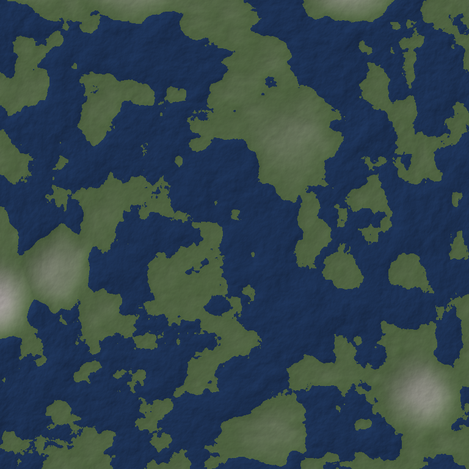
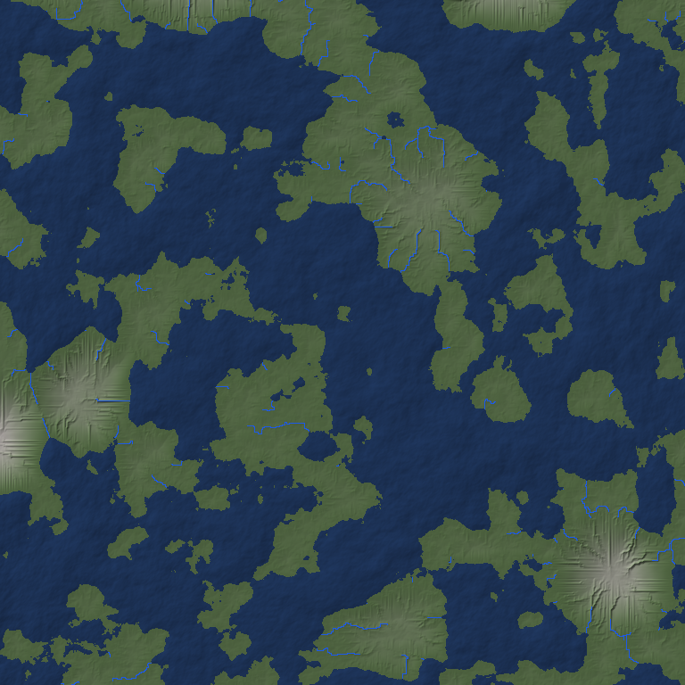
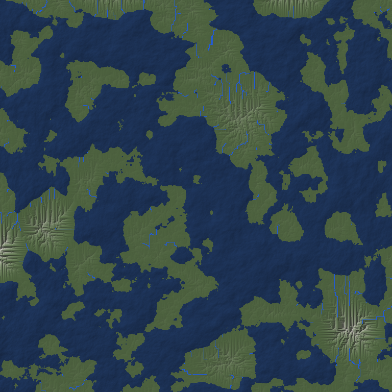

# Research: hydraulic erosion on the world map

Resolves [#241](https://github.com/theHimanshuShekhar/BhayanakVoxel/issues/241), part of the terrain map [#238](https://github.com/theHimanshuShekhar/BhayanakVoxel/issues/238). Researched 2026-11-24 against `main` at `03fc6e3`. Terms follow [`CONTEXT.md`](../../CONTEXT.md): the Planet, and the "world map" for the 245 m texel map only.

## TL;DR

- **Method:** use the **stream power law** with `n = 1` and `m = 1/2`, solved by **Braun & Willett's implicit O(n) tree solver** (FastScape) on the map's own texel graph, with D8 or multiple-flow routing (D4's grid bias shows plainly in the benchmark). Route water through depressions with a **basin graph** (Cordonnier, Bovy & Braun 2019) or a priority-flood. Follow it with today's thermal pass as the slope limit. This is the one method that gives drainage-consistent dendritic valleys at 245 m, reaches its result in tens of steps instead of thousands, and keeps to `+ - * /` and `sqrt` with a fixed order.
  - With `n = 1` the solve is one division per texel and needs no Newton iteration.
  - With `m = 1/2` the area term is `sqrt(A)`.
  - The other common exponents (`m = 0.4`, Schott's `0.8` and `2.0`, a flow exponent of `1.3`) need `pow`, which ADR 0003 forbids.
- **Mode:** **don't run uplift to steady state at full size.** Doing so (Cordonnier et al. 2016) gives the best ranges, but takes 100–300 steps. At 6×2048² that is minutes, past ADR 0008's "well under a minute". Two ways fit the budget:
  - **Amplification:** a few tens of implicit steps on today's continent-and-noise heights. This is Schott et al. 2024's framing, with "no uplift".
  - **Coarse to fine:** uplift to steady state on a coarse map, then upsample and run a few steps at 2048. Cordonnier et al. 2016 suggest this, and Schott et al. 2024 build their method on it.
- **Measured here** (throwaway Rust benchmark on the real 6×2048² map, this 8-core box, see [Measurements](#measurements)):
  - One FastScape step: **2.4 s** on one thread, **1.9 s** on 8 threads. Other jobs held a load of 20–40 on the 8 cores throughout, and the map itself took 48–88 s instead of the usual 26 s, so read these as about 2× too slow. The benchmark is also unoptimised: it walks every texel, ocean included.
  - One Schott-style explicit step: **0.41–0.45 s** on 8 threads. That method needs hundreds to thousands of steps.
  - **Both gave the same hash on 1 and 8 threads.**
- **Cube faces:** every graph method only needs a neighbour function, and `world_map::step` already is one across the edges and corners. Erosion on the global graph has no seams by construction. That is the reason ADR 0008 gives for rejecting regional maps: "erosion does not tile".
- **Below 245 m:** keep the method's **river graph**, not just its heights.
  - Store each texel's receiver (3 bits for D8) beside the drainage it already has.
  - Per brick, rebuild the river polyline through the 3×3 texels around it, jittered by the integer hash, and carve a channel and valley from the distance to it. The width and depth follow the drainage area.
  - This is stateless, seamless across faces, and costs a few distance tests per column. It is the stream-graph-to-primitives step of Génevaux et al. 2013 and Cordonnier et al. 2016.
  - Droplet erosion and whole-map multi-scale amplification can't carry anything below the texel without breaking ADR 0008.
- **Not recommended:**
  - **Droplets/particles:** gullies at the brush's scale (radius 3 texels, about 1.5 km wide) instead of continental drainage. Deterministic only when serial (Lague's GPU version races on the height buffer). Awkward across faces.
  - **Explicit GPU-style iteration (Schott 2023)** as the main solver: thousands of steps on a CPU, and GPU floats are not bit-identical (WGSL's `sqrt` is not correctly rounded).
  - **Analytic erosion (Tzathas et al. 2024)** for now: promising, deterministic in principle, but more machinery than FastScape. Its prototype is Python/numba and takes 34 s for one 2048² domain.

**Plain-language recommendation:** Simulate rivers cutting into the land with the standard geology formula: each river cuts faster where it's steep and where more water flows through it. Solve it the fast way geologists do, by walking each river tree from the sea upstream so that every texel can be finished in one step. Do it on the whole cube map at once so there are no seams, keep the maths to the safe operations, and keep the river tree, so that bricks can draw river channels narrower than a texel.

---

## 1. What the method has to fit

Read from `crates/planet-gen/src/world_map.rs` at `03fc6e3`:

- **Grid.** Six faces of 2048² texels (`WORLD_MAP_SIZE`), about 245 m each at 320 km (`with_radius`; ADR 0008). Faces are warped by a quadratic so the largest texel is about twice the smallest (`warp`, test `texels_are_within_a_factor_of_two_of_each_other_in_area`).
- **Heights.** `i16` in 10 cm units; −1 km to +2 km after `normalise`; sea level 0. 54% of the area is ocean (`OCEAN_SHARE`).
- **Erosion today.** `erode` is thermal only. It makes `size / 16` Jacobi sweeps (128 at 2048) on integers: each texel sheds an eighth of its height over the talus to each lower D4 neighbour. Every sweep reads the last sweep's heights, so the result does not depend on the thread count.
- **Drainage today.** `drainage` uses a counting sort by height, highest first, then single-flow D4 to the lowest lower neighbour (first on a tie). It accumulates texel counts in `u32` and stores 16 × log₂ in a `u8`. Water that reaches a pit stops there ("down to the sea or to a pit"): **there is no depression routing**. So inland basins end rivers. The map carves no valleys at all; only `detail.rs` cuts its 3 m valley per brick.
- **Neighbours across faces.** `step(size, face, i, j, side)` returns the D4 neighbour on the adjacent face when a step leaves a face. A step back returns to the start (test `stepping_across_a_cube_edge_lands_beside_the_texel_and_can_be_undone`). Every pass above already uses it, which is why the map has no seams.
- **Detail below the texel.** `detail.rs` adds 7 octaves of value noise (3 ridged) scaled by the map's `rough`. Where `drainage` is high it cuts a valley at most 3 m deep (`VALLEY`). All fields are bilinear between texel centres.
- **Rules.** The module doc and ADR 0003 allow only `+ - * /`, `sqrt` and conversions; per-texel functions of read-only inputs; integer sums. A changed output bumps `GENERATOR_VERSION`, which also keys the map's cache on disk, so the map is made once per seed and version, not on every start.

ADR 0003's determinism rules, as checked for each method below. Floats are exact for `+ - * /` and `sqrt` in Rust; transcendentals (`powf`, `exp`, …) are not; never sum floats across threads ([deterministic-generation.md](deterministic-generation.md) §rules 2, 3, 5).

## 2. The methods

### 2.1 Stream power law, implicit tree solver (Braun & Willett 2013; Cordonnier et al. 2016)

**What it is.** The stream power incision model says the ground rises with uplift `u` and is cut by rivers at `k·A^m·S^n`, where `A` is the drainage area and `S` the slope ([Braun & Deal 2023, eq. 20](https://doi.org/10.1029/2023JF007140), restating [Braun & Willett 2013](https://doi.org/10.1016/j.geomorph.2012.10.008)). Braun and Willett's FastScape algorithm discretises the slope between a node `i` and its single downstream "receiver" `r`, implicitly in time:

- `h_i(t+Δt) = h_i(t) − Δt·k·A_i^m/Δx^n · (h_i(t+Δt) − h_r(t+Δt))^n`
- With `n = 1` this solves directly as `h_i = (h_i0 + F·h_r)/(1 + F)`, where `F = Δt·k·A_i^m/Δx`, "if nodes are processed in stack order", in which "any node i follows its receiver r" ([Braun & Deal 2023, eqs. 21–23](https://doi.org/10.1029/2023JF007140)).
- With `n ≠ 1` it needs a Newton–Raphson root find per node (same source, eqs. 24–26).

Drainage areas are accumulated in the reverse of the same order, so a step is O(n). Being implicit, it "does not need to satisfy the CFL condition" ([Braun & Deal 2023](https://doi.org/10.1029/2023JF007140), abstract).

Cordonnier et al. 2016 brought it to graphics: the user paints uplift, and the method generates "large realistic terrains at a low computational cost", with "high-level control over the large scale dendritic structures of the resulting river networks, watersheds, and mountains ridges" ([paper PDF](https://www.cs.purdue.edu/cgvlab/www/resources/papers/Cordonnier-Computer_Graphics_Forum-2016-Large_Scale_Terrain_Generation_from_Tectonic_Uplift_and_Fluvial_.pdf), abstract).

- **Exponents.** "As in most geomorphological studies, we use n = 1 and m = 0.5" (§3.1).
- **Lakes.** Water that ends in a lake overflows through the lowest "pass" into the next basin, using a graph of lakes processed in increasing pass height (§4.3).
- **Slope limit.** Where stream power would leave slopes over 30°, they cap the change, as a thermal correction (§5).
- **Steps.** Mountains are "fully shaped after 50 iterations and the geometry stops evolving after 100−300 iterations". Thanks to the implicit solve, the count "does not depend on the resolution of the terrain" (§6.3).

**Look.** This is the method that produces real drainage networks: every texel's water reaches the sea or a lake, and valleys deepen where the area is large. Cordonnier et al. compare a result with the San Gabriel mountains and find "coherent and plausible large scale dendritic patterns" (§6.1). The authors' library [fastscapelib](https://github.com/fastscape-lem/fastscapelib) is the reference implementation:

- the implicit solver, with a linear fast path and Newton for `n ≠ 1`, is in `include/fastscapelib/eroders/spl.hpp`;
- depression handling is in `flow/sink_resolver.hpp`: Barnes et al. 2014's priority-flood+ε, or Cordonnier 2019's minimum spanning tree;
- a HEALPix sphere grid is in `grid/healpix_grid.hpp`. The method works on any graph, including a sphere.

**Determinism under ADR 0003.** Yes, if built this way:

- **Exponents:** `n = 1` (no Newton) and `m = 1/2`, so `A^m` is `sqrt(A)`. fastscapelib's general path calls `std::pow(drainage_area * weight, m_area_exp)` (`spl.hpp`), which ADR 0003 forbids; the standard pair avoids it. Other `m` would need a pinned `libm`. Even then, `m/n` sets the river profile's concavity, and 0.5 is the textbook ratio (Cordonnier et al. 2016, §6.4).
- **Receivers:** a pure function of the heights (lowest lower neighbour, ties by side index), filled per texel.
- **Order:** a breadth-first walk from the roots in index order, either serially or Barnes's way. Barnes 2019 replaces the depth-first "stack" with a breadth-first "queue" whose levels "may be processed concurrently". He has each cell find its donors instead of donors writing to it, because the push version is "a race condition" ([Barnes 2019, arXiv 1803.02977](https://arxiv.org/abs/1803.02977), §5.3–5.4). Within a level, each texel reads only the level before, so the result is the same on any thread count.
- **Area:** sum integer texel counts, or the `u32` area weights `area_weights` already computes, in `u64`. The sums are then exact in any order, and `sqrt` of an exact integer is exact.
- **Measured here:** the level-parallel version gave the same hash on 1 and 8 threads ([Measurements](#measurements)).

**Cost.** Barnes 2019 timed 120 steps on a 10,000² grid (10⁸ cells):

- serial Braun & Willett: about 3,000 s;
- his best GPU version: 70 s (abstract);
- with all steps parallelised on CPU: "10 s for the 1000² dataset and 1200 s for the 10,000² dataset" (§9.2, on 2016 POWER8 nodes).

The map is 2.5 × 10⁷ texels. **Measured on it here: 2.4 s a step serially and 1.9–2.0 s on 8 threads, under a host load of 20–40** ([Measurements](#measurements)). Routing through depressions by a serial priority-flood over the whole map cost 6.9–7.5 s a step on its own. How many steps:

- amplification (erode the existing map) needs, by my estimate, tens. Schott et al. 2024 use 500–2,000 *explicit* iterations at 2048² (their Table 1); an implicit step can be much longer, as it has no stability limit. The benchmark's 10 steps already cut deep valleys;
- uplift to steady state needs 100–300 (Cordonnier et al. 2016).

**Cube faces.** It needs a graph, and `step` gives the D4 graph of the whole cube with no seams. Use the true distance between texel centres for `Δx` and the texel's area weight in `A`, since texels vary by 2× in area.

- **D4 grid bias.** D4 routing gives grid-aligned channels. Cordonnier et al. used a jittered Delaunay graph because random edges "better represent possible directions for local streams" (§4.1). Frozen Fractal saw "directional (horizontal/vertical) artifacts" with a grid-aligned stream power ([devlog part 23](https://frozenfractal.com/blog/2025/6/6/around-the-world-23-hydraulic-erosion/)).
- **D8.** D8 inside faces, with diagonals across edges made by two `step`s and the 8 cube corners left at D4, reduces the bias. The benchmark's pictures show D4's bias plainly at 245 m ([Measurements](#measurements)), so D4 is not enough.

**Below 245 m.** The solver leaves a tree: each texel's receiver and drainage area. That is exactly the river network that per-brick detail can draw at any resolution ([§4](#4-carrying-the-result-below-245-m)).

### 2.2 Iterative flow routing, GPU style (Schott et al. 2023; 2024)

**What it is.** Schott et al. 2023 paint uplift and simulate stream power interactively, relying on "a fast yet accurate approximation of drainage area and flow routing" ([HAL record](https://hal.science/hal-04049125v1), abstract; the HAL PDF sits behind an anti-bot wall that blocked my fetches, so the method below is read from the authors' code and from their 2024 paper, which restates it).

- **Shader.** The release code ([H-Schott/StreamPowerErosion](https://github.com/H-Schott/StreamPowerErosion), `data/shaders/spe_shader.glsl`) does one double-buffered compute pass per step. Each texel reads the previous buffers only.
- **Drainage.** It relaxes the drainage once: its own cell area plus each uphill neighbour's area times that neighbour's flow fraction, `pow(s, p_flow)/Σ pow(s', p_flow)` over 8 neighbours.
- **Erosion.** It erodes explicitly toward the steepest receiver: `k·pow(A, p_sa)·pow(S, p_sl)`, with defaults `p_sa = 0.8`, `p_sl = 2.0`, then clamps the new height to no lower than the receiver's (`newH = max(newH, receiver.x)`). It adds hillslope diffusion and uplift.
- **Borders:** fixed at height 0.

Schott et al. 2024 ([HAL PDF](https://hal.science/hal-04565030v1), code at [H-Schott/MultiScaleErosion](https://github.com/H-Schott/MultiScaleErosion)) reuse this for amplification. "We calculate an iterative drainage approximation using a parallel implementation [Schott et al. 2023]", with a flow exponent `p = 1.3` "to avoid sharp fluvial incision" and `m/n = 0.5` (§4.1–4.2). Because the terrain changes little per step, "only one iteration of flow routing is required" each step (§4.1). They drop uplift to keep the input's large shapes and carve "through a few iterations involving only the stream power term". They clamp slope and area to avoid "plunging erosion features" on steep slopes (§4.2).

**Look.** Good dendritic valleys, and multiple-flow routing softens single-texel incisions. But the drainage approximation only moves water one texel per step. Depressions trap it:

- Tzathas et al. 2024 note that GPU stream-power simulations lack depression breaching, which is "particularly visible in cases where we erode without uplift – all the water is trapped within the depressions" ([paper](http://www-sop.inria.fr/reves/Basilic/2024/TGSC24/Analytical_Terrains_EG.pdf), §7.1).
- Frozen Fractal, using Schott's iterative drainage on a 2048×1024 planet map, got "a large number of inland lakes below sea level" ([devlog part 23](https://frozenfractal.com/blog/2025/6/6/around-the-world-23-hydraulic-erosion/)).
- Schott et al. 2024 fix the result afterwards with a multi-scale breaching pass on the CPU. Together with their height retargeting it takes "a few seconds" at 4096² (§6.4).

**Determinism.** The pass is a pure function of the previous buffers, like today's `erode`, so a **CPU port is deterministic** if:

- the exponents are changed to `p_flow = 1`, `m = 1/2`, `n = 1`, removing every `pow`;
- the sums run over neighbours in a fixed order.

Measured here: same hash on 1 and 8 threads. **On the GPU it is not bit-identical across vendors.** WGSL defines `sqrt` as "inherited from 1.0 / inverseSqrt(x)", and `inverseSqrt` is allowed 2 ULP ([WGSL spec](https://www.w3.org/TR/WGSL/), floating-point accuracy table). ADR 0003 needs every client to agree bit for bit.

**Cost.** On the GPU it is fast. Schott et al. 2024 time one erosion iteration at 1.27 ms for 2048² and 5.07 ms for 4096² on an "NVidia GTX 3080" (so written; §6, Table 2), but use 300–7,400 iterations per resolution (Table 1). On this box's CPU, **one step of the port took 0.41–0.45 s on 8 threads** (under load). A thousand steps is minutes.

**Cube faces.** It works with any neighbour function, so it is seamless with `step`; the 8-neighbour version needs the corner special case of §2.1.

**Below 245 m.** Heights and a multiple-flow drainage field; no tree. Rivers would have to be traced from it afterwards.

### 2.3 Analytic erosion (Tzathas et al. 2024)

**What it is.** For `n = 1` the stream power law is "an advection of the initial terrain along the rivers, at a velocity k·A^m". Its solution by characteristics gives the height at any time `t` directly: `z(x,t) = z0(D_{x,t}) + ∫ u/a ds` along the river path (eq. 8, with `a = k·A^m`). So "time is no longer the stopping criterion of an iterative process but acts as the parameter of a mathematical function, a slider" ([paper](http://www-sop.inria.fr/reves/Basilic/2024/TGSC24/Analytical_Terrains_EG.pdf), abstract and §4.1).

- **Order:** the 1D solution runs in linear time along each river tree, ordered like FastScape (§4.2–4.3).
- **Basins:** because the tree depends on the heights, they iterate to a fixed point. Basin boundaries "can only move by one cell per iteration", which they accelerate with a multigrid-inspired scheme (§3.2, §5).
- **Ridges:** they add landslides and hillslope terms for the slope singularity at ridges (§6).
- **Depressions:** breached on the CPU (§7.1).

**Look.** The same stream-power landscapes as simulation: they match a Cordonnier 2016 simulation's hypsometry at steady state (§7.1, Fig. 5). Plus a single "how eroded" parameter, which is attractive for authoring.

**Determinism.** In principle: the operations are sums of `δx/a` along trees, divisions, linear interpolation, and `A^m`. The paper uses `m = 0.4` (Table 1), which needs `pow`, so `m = 1/2` would be required. "Hack's law" with exponent 0.6 also appears in its parameters, and its use would need checking. The tree passes are serial or level-parallel as in §2.1.

**Cost.** Prototype in Python with numba on a Xeon E5-2650 v4 (§7). One 2048² domain took 33.65 s with multigrid, against 4,799 s for their simulation baseline (Table 2). Six faces would be about 200 s in that prototype; a Rust port would be faster but is not measured. Code: [gitlab.inria.fr/landscapes/analytical-terrains](https://gitlab.inria.fr/landscapes/analytical-terrains) (§7; not read here).

**Cube faces / below 245 m.** As §2.1: it is built on the same river trees.

**Verdict.** A good second step if a "slider" of erosion amount is wanted. It is more machinery (the fixed point, multigrid over a cube map, the discontinuity optimisation) for the same physics as FastScape.

### 2.4 Droplet / particle erosion (Beyer 2015; Lague)

**What it is.** Each droplet starts at a random cell and moves downhill on the bilinear gradient with inertia. It erodes within a brush radius when it can carry more and deposits when it carries too much, evaporating as it goes ([Beyer 2015, TUM bachelor's thesis](https://www.firespark.de/resources/downloads/implementation%20of%20a%20methode%20for%20hydraulic%20erosion.pdf), §5; the site's TLS certificate is self-signed).

Lague's widely copied implementation ([SebLague/Hydraulic-Erosion](https://github.com/SebLague/Hydraulic-Erosion)) defaults to 50,000 droplets on a 255² map (`TerrainGenerator.cs`), a lifetime of 30 steps and a brush radius of 3 (`Erosion.cs`).

**Look.** Good at the scale it is tuned for: ravines and sediment fans a few cells wide on maps of metre-scale cells. At 245 m a texel, a radius-3 brush cuts gullies about 1.5 km wide, and a 30-step droplet travels about 7 km. Neither forms the continental drainage that rivers must follow; there is no network, only carved heights.

- Beyer reports "drain valleys" growing in from the map's edges, where droplets leave with their sediment (§5).
- Frozen Fractal rejected classic droplets as "relatively slow", "hard to parallelize" and unfriendly to caches. They ended on a grid hybrid: "exactly one droplet in each grid cell", each moving one cell a step and merging when they meet, "less than 1.5 seconds for a 2048×1024 map" in 20 iterations ([devlog part 23](https://frozenfractal.com/blog/2025/6/6/around-the-world-23-hydraulic-erosion/)). That is a practitioner's report on a flat map, not peer reviewed.

**Determinism.**

- **Serial with hashed spawns:** deterministic.
- **Lague's GPU version:** not deterministic. Many droplets read and write `map[...]` concurrently with plain `+=`/`-=` and no atomics (`Erosion.compute`).
- **Frozen Fractal's merge:** a scatter whose float sums depend on arrival order unless rewritten as a gather in a fixed order.

**Cost.** **Measured here: one serial pass, one droplet per land texel of one face (1.95 million droplets, about 29 steps each), took 3.8 s** (66 ns a droplet step), so about 23 s per pass over six faces. Usual practice runs many passes.

**Cube faces.** A droplet crossing an edge must move to the next face's coordinates and keep its direction. That can be done with `step`'s frame change but is fiddly at corners, and brushes span faces.

**Below 245 m.** Nothing but the heights.

### 2.5 Not studied here

- **Shallow-water pipe models** (Mei et al. 2007 and descendants). The only first-hand report found is Frozen Fractal's: "weird artifacts at best, and numerical instability at worst", and branches "strictly horizontal or vertical". They are explicit, CFL-bound fluid solvers tuned to metre scales; I did not read the paper.
- **Learning-based amplification** (cited by Schott et al. 2024 §2): not considered.

## 3. Comparison

| | Stream power, implicit (FastScape) | Iterative GPU-style (Schott 2023) | Analytic (Tzathas 2024) | Droplets (Beyer/Lague) |
|---|---|---|---|---|
| **Dendritic valleys at 245 m** | Yes, drainage-consistent; lakes route through passes | Yes, but water trapped in depressions until breached | Yes, same physics | No network; brush-scale gullies |
| **Rivers can follow it** | Yes: the receiver tree *is* the river network | Needs tracing after | Yes: river trees | No |
| **Steps to a result** | 10s (amplify); 100–300 (steady state) | 300–7,400 explicit | 1 evaluation + fixed point | Many passes |
| **Cost at 6×2048², 8 cores** | 1.9 s/step measured (8 threads, loaded host) | 0.41–0.45 s/step measured (8 threads, loaded host) | ~200 s in Python (scaled from paper) | 23 s/pass measured (serial) |
| **ADR 0003** | Yes with `n=1`, `m=1/2`, integer area, fixed order | CPU port yes (`p=1`, `m=1/2`, `n=1`); GPU no | Yes in principle with `m=1/2` | Serial only |
| **Cube faces** | Graph: seamless with `step` | Seamless with `step` | Seamless | Fiddly |
| **Below 245 m** | Tree + area → channels per brick | Drainage field | Tree | Heights only |

## 4. Carrying the result below 245 m

ADR 0008 allows nothing precomputed below the texel; everything finer is a deterministic per-brick function. So what crosses the boundary is what the map stores per texel. Options, best first:

1. **Store the river tree, draw channels per brick.**
   - **Store:** add the receiver (3 bits for D8, 2 for D4) to the texel, beside `drainage`, which becomes the solver's exact area, log-encoded as today.
   - **Draw:** a brick takes its texel's 3×3 neighbourhood (across faces with `step`). It forms the segments from each texel's river point to its receiver's, where each point is the texel centre jittered by the integer hash. It then carves a channel from the distance to the nearest segment, with width and depth from the drainage, plus a valley side slope from the eroded elevation.
   - **Properties:** stateless, the same on every machine, and seamless at face edges because both sides read the same texels and receivers. The cost is a handful of point-to-segment distances per column, which should be small next to today's whole per-brick cost of 50–54 µs at level 0 (#166). That is an estimate, not measured.
   - **Prior art:** Génevaux et al. 2013 build terrain from a river graph, subdividing river paths and randomly perturbing "positions and tangents" by river type, with junction angles set by the flows ([paper](https://www.cs.purdue.edu/cgvlab/www/resources/papers/Genevaux-ACM_Trans_Graph-2013-Terrain_Generation_Using_Procedural_Models_Based_on_Hydrology.pdf), §6.1). Cordonnier et al. 2016 convert their stream graph to terrain the same way, with "rivers carved by using the elevation and drainage information embedded in the graph" (§6.2). A 2026 arXiv preprint (single author, not peer reviewed) does the same for infinite worlds: "the distance to the cached river network is computed exactly, and river height is interpolated along nearby segments" ([Davis 2026, arXiv 2610.00301](https://arxiv.org/abs/2610.00301)).
   - **Scope:** this is also #206's river design (lakes come from the depression routing: a priority-flood's spill level is a lake surface), so the store format should be decided with #206.
2. **Orient the hillslope detail by the map.** Replace part of the isotropic ridged noise with gullies aligned to the map's gradient and scaled by drainage, as in Grenier et al. 2024's phasor-noise ravines "with various scales, amplitude and orientations depending on the characteristics of the terrain, in real time" ([Wiley](https://onlinelibrary.wiley.com/doi/10.1111/cgf.14992); summary via search, paper not read). Phasor and Gabor noise use `cos` and `exp`, so they would need polynomial stand-ins under ADR 0003.
3. **Not suitable:**
   - **Dendry** (Gaillard et al. 2019) is "locally computable" and dendritic but costs about "ten seconds for a 512 × 512 resolution grid on the CPU" ([paper](https://www.mgaillard.fr/content/publications/pdfs/Gaillard19I3D.pdf), abstract). That is about 40 µs a sample, against today's whole per-brick cost of 50–54 µs (#166).
   - **Schott et al. 2024's multi-scale amplification** "requires the processing of the entire elevation map at every step". Beyond 8192² it needs patches, which brings "the propagation of drainage across the boundaries of the patches, and their seamless blending" (§6.6). Both break ADR 0008.

## 5. Recommendation

1. **Solver.** FastScape on the cube's texel graph: `n = 1`, `m = 1/2`, implicit, in a fixed order.
   - **Each step:** receivers (per texel), donors (per texel, a gather), order (breadth-first from roots in index order), area (integer gather, reverse order), solve (forward order).
   - **Parallelism:** level-parallel as in Barnes 2019; the receivers and donors as `par_fill`.
   - **Precision:** keep heights in `f64` while eroding and round to `i16` at the end, as today.
2. **Depressions.** Route through them each step. A priority-flood over the whole map costs 6.9–7.5 s a step serially, measured, which is too slow for every step. Use the basin graph instead:
   - Receivers, then basins (roots that are not ocean), then their passes, then a minimum spanning tree in increasing pass height, with ties by index.
   - fastscapelib's `mst_sink_resolver` uses Kruskal by default; Cordonnier et al. 2019 give a linear Boruvka variant for planar graphs ([ESurf](https://esurf.copernicus.org/articles/7/549/2019/)).
   - The number of basins is much smaller than the number of texels, so this keeps the step parallel.
3. **Mode.** Pick by the spec:
   - **Amplify:** erode today's heights for a few tens of steps, no uplift. It keeps the continents and #238's landforms, and adds about 20–100 s at the measured speed, less once optimised.
   - **Coarse to fine:** uplift from the landform field to steady state on a coarse map, then upsample and amplify at 2048. Ranges come from erosion, and it costs more.
   - Both follow with the existing thermal `erode` as the slope limit (Cordonnier's 30° cap).
4. **Store.** Exact drainage plus receiver per texel, and the lake level for #206.
5. **Per brick.** Channels and valleys from the river tree (§4.1), replacing `detail.rs`'s 3 m `VALLEY` cut.
6. **Routing.** Use **D8 or multiple-flow, not D4.** The benchmark's D4 channels are visibly grid-aligned ([Measurements](#measurements)). D8 needs the diagonal across a face edge (two `step`s) and a rule at the 8 cube corners. fastscapelib's implicit solver also takes multiple receivers with weights.
7. **Validate** with the look-dev tour on the 4090 and a landscape golden.

## Measurements

A throwaway Rust benchmark, outside the workspace: [`hydraulic-erosion/bench/`](hydraulic-erosion/bench/). It depends on `planet-gen` and reads the real map of the test seed `0xB4A7A9AC` at 6×2048² (`WorldMap::generate`). It copies `step` for the cube neighbours. Heights go to `f64` metres, and ocean texels are the base level at sea level. Run on this dev box (8 cores, 16 GB) on 2026-11-24, while other sessions' jobs held a load average of 20–45. The raw logs are in `bench/run-*.txt`.

**Cost per step** (ms; mean of 3 steps; the second run at a load of about 20, with the first at about 40 in brackets):

| Variant | Total | Receivers | Donors | Order | Area | Solve |
|---|---|---|---|---|---|---|
| FastScape, D4, pits as lakes, 1 thread | 2,397 (2,467) | 131 | 703 | 248 | 405 | 831 |
| Same, 8 threads, level-parallel | 1,949 (2,048) | 54 | 508 | 276 | 355 | 659 |
| FastScape with priority-flood routing (serial flood) | 9,087 (8,565) | 7,502 (flood) | 455 | – | 371 | 690 |
| Schott-style Jacobi step, 1 thread | 690 (815) | | | | | |
| Schott-style Jacobi step, 8 threads | 453 (410) | | | | | |
| Droplets, serial, 1 per land texel, one face | 3,800 for 1.95 M droplets (66 ns a droplet step) → about 23 s for six faces | | | | | |

For scale, the whole of today's map took **47.6 s and 87.7 s** in these two runs, against the usual 26 s, so the host was 1.8–3.4× oversubscribed.

- **Determinism:** the 1- and 8-thread FastScape runs gave the same hash (`f495b6eb4614f51c`), and so did the two Schott runs (`98daadf7d469ad5a`).
- **Levels:** with pits as their own lakes the D4 trees are at most 177 levels deep. Each level is one barrier in the parallel passes.
- **Why parallel helps so little:**
  - `donors` builds a temporary vector and copies it;
  - every pass walks ocean texels too (54% of the map);
  - the solve clones the heights each step;
  - the host was oversubscribed.

  These are fixable; the numbers are an upper bound for this machine under this load, not a target.
- **Flood routing:** a whole-map priority-flood (binary heap, ties by index) is 7–7.5 s on its own. That is why §5 recommends the basin graph, which only sorts the passes between basins. The basin graph was not measured here.

**What that costs a map**, scaled from the measured 1.9–2.4 s a step (estimates, not runs):

- **Amplify, 10–40 steps:** 20–100 s on top of today's 26 s.
- **Uplift to steady state at 2048, 100–300 steps:** 3–12 min.
- **Coarse to fine, steady state on 6×512² then 10–20 steps at 2048:** 6×512² is 1/16 of the texels, so 200 coarse steps at about 0.15 s is about 30 s, plus 20–50 s at full size. About a minute.

**Look** (the face with the most land, the central 768×768 texels, 188 km across). These are *untuned* parameters, to see the character, not the final look:

| Today's map (thermal only) | FastScape, erosion only, 10 steps, flood routing | FastScape, uplift ∝ today's height, 40 steps, flood routing |
|---|---|---|
|  |  |  |

Blue lines are texels draining more than 400 texels (24 km²).

- **Erosion only** (`k = 5e-7`, `Δt = 2e5`): this turns today's smooth continent domes into radial valley systems whose rivers reach the coast. It cut up to 948 m in 10 steps; `k` would be lowered.
- **Uplift** (`u` up to 2e-4 m/yr in proportion to today's height above sea level, `k = 6e-7`, `Δt = 1e6`, land started flat at 0): ridge-and-valley texture over the uplifted ground. After 40 steps it is **not converged**: the largest change is still 149 m a step, and the highest point 2.6 km overshoots `PEAK`. That fits Cordonnier's 100–300 steps.
- **Both show the D4 grid bias plainly:** long straight north–south and east–west channels. This is the strongest look finding here. D8 or multiple-flow routing, or a jittered graph as in Cordonnier 2016, should be in the first prototype.

## Open questions for #238's spec

- **Budget:** is a map generation of about a minute acceptable, since it is cached per seed and version? That decides amplify against coarse-to-fine steady state.
- **Uplift source:** if steady state is wanted, what is the uplift? Continent shape, a mountain-range field from the landform work, or both.
- **D8, multiple-flow, or a jittered graph:** D4 is ruled out by the look here. The choice among the others is for the prototype.
- **Format:** the receiver, area and lake fields, decided together with #206.

## Sources

Primary, read for this note:

- Braun, J. & Willett, S. D. (2013). A very efficient O(n), implicit and parallel method to solve the stream power equation. *Geomorphology* 180–181, 170–179. [doi:10.1016/j.geomorph.2012.10.008](https://doi.org/10.1016/j.geomorph.2012.10.008). The original was not reachable; read through its restatement in Braun, J. & Deal, E. (2023), *JGR Earth Surface* 128, [doi:10.1029/2023JF007140](https://doi.org/10.1029/2023JF007140), §5, by the same first author.
- Cordonnier, G. et al. (2016). Large scale terrain generation from tectonic uplift and fluvial erosion. *CGF* 35(2). [PDF](https://www.cs.purdue.edu/cgvlab/www/resources/papers/Cordonnier-Computer_Graphics_Forum-2016-Large_Scale_Terrain_Generation_from_Tectonic_Uplift_and_Fluvial_.pdf).
- Cordonnier, G., Bovy, B. & Braun, J. (2019). A versatile, linear complexity algorithm for flow routing in topographies with depressions. *ESurf* 7, 549–562. [Open access](https://esurf.copernicus.org/articles/7/549/2019/).
- fastscapelib (authors' library): [github.com/fastscape-lem/fastscapelib](https://github.com/fastscape-lem/fastscapelib), files cited above, read at the default branch on 2026-11-24.
- Barnes, R. (2019). Accelerating a fluvial incision and landscape evolution model with parallelism. *Geomorphology*; preprint [arXiv:1803.02977](https://arxiv.org/abs/1803.02977).
- Schott, H. et al. (2023). Large-scale terrain authoring through interactive erosion simulation. *ACM TOG* 42(5). [HAL](https://hal.science/hal-04049125v1) (PDF not reachable: anti-bot wall); code [H-Schott/StreamPowerErosion](https://github.com/H-Schott/StreamPowerErosion).
- Schott, H. et al. (2024). Terrain amplification using multi-scale erosion. *ACM TOG* 43(4). [HAL PDF](https://hal.science/hal-04565030v1); code [H-Schott/MultiScaleErosion](https://github.com/H-Schott/MultiScaleErosion).
- Tzathas, P. et al. (2024). Physically-based analytical erosion for fast terrain generation. *CGF* 43(2). [Author PDF](http://www-sop.inria.fr/reves/Basilic/2024/TGSC24/Analytical_Terrains_EG.pdf).
- Beyer, H. T. (2015). Implementation of a method for hydraulic erosion. Bachelor's thesis, TUM. [PDF](https://www.firespark.de/resources/downloads/implementation%20of%20a%20methode%20for%20hydraulic%20erosion.pdf).
- Lague, S. Hydraulic-Erosion: [github.com/SebLague/Hydraulic-Erosion](https://github.com/SebLague/Hydraulic-Erosion) (`Erosion.cs`, `Erosion.compute`, `TerrainGenerator.cs`).
- Génevaux, J.-D. et al. (2013). Terrain generation using procedural models based on hydrology. *ACM TOG* 32(4). [PDF](https://www.cs.purdue.edu/cgvlab/www/resources/papers/Genevaux-ACM_Trans_Graph-2013-Terrain_Generation_Using_Procedural_Models_Based_on_Hydrology.pdf).
- Gaillard, M. et al. (2019). Dendry: a procedural model for dendritic patterns. I3D. [PDF](https://www.mgaillard.fr/content/publications/pdfs/Gaillard19I3D.pdf).
- W3C WGSL specification, floating-point accuracy: [w3.org/TR/WGSL](https://www.w3.org/TR/WGSL/).

Secondary or unreviewed, marked where used:

- Frozen Fractal, "Around the World, Part 23: Hydraulic erosion" (2025): [devlog](https://frozenfractal.com/blog/2025/6/6/around-the-world-23-hydraulic-erosion/). A practitioner's first-hand report.
- Davis, M. K. (2026). Plate-local river generation. [arXiv:2610.00301](https://arxiv.org/abs/2610.00301): preprint, abstract read only.
- Grenier, C. et al. (2024). Real-time terrain enhancement with controlled procedural patterns. *CGF* 43. [Wiley](https://onlinelibrary.wiley.com/doi/10.1111/cgf.14992): abstract via search summary only.
